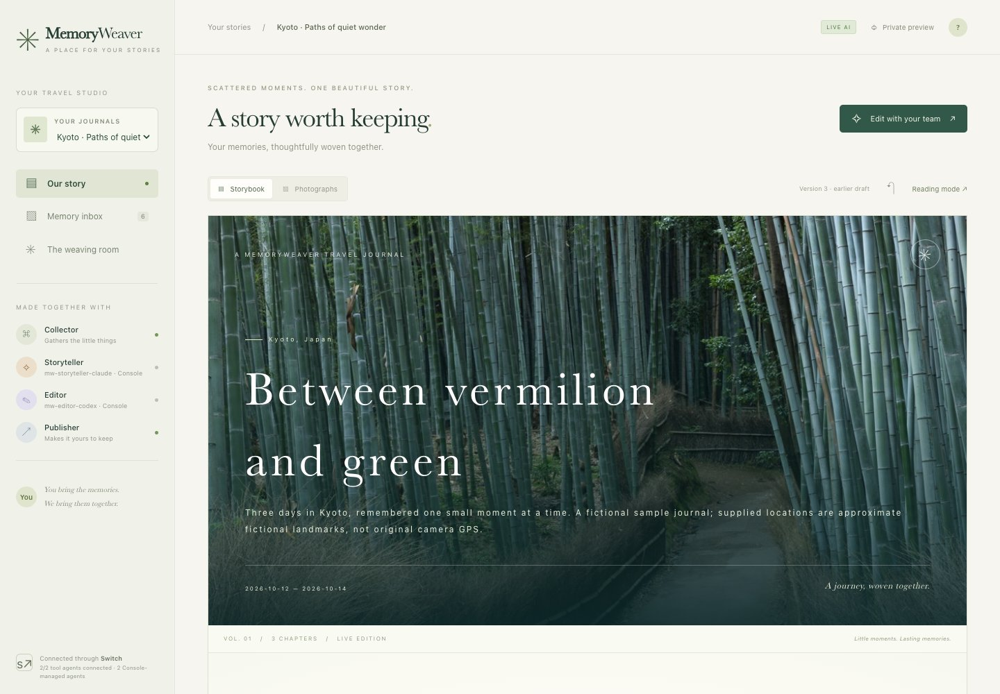
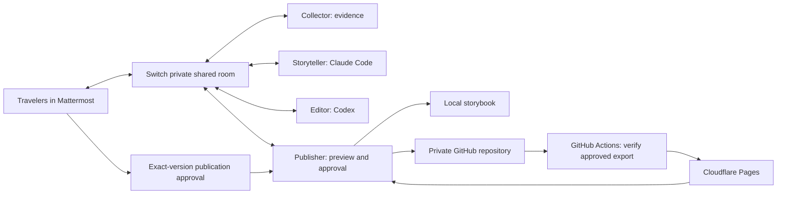

# MemoryWeaver

**Turn Scattered Memories into Beautiful Stories.**

A photograph beneath vermilion gates. A message from a walk along the Seine. A quiet “let’s come back.” MemoryWeaver brings those fragments together into a travel book, with people and AI teammates sharing one creative room through **Switch**.

Built for [Flip the Switch](https://www.wemakedevs.org/hackathons/switch), Track 2: Best Personal or Creative Workflow.



## Judge setup: reproduce the live Switch Console workflow

This is the workflow exercised during development: **Mattermost → Switch → Console-managed Claude Storyteller → Console-managed Codex Editor → Publisher → local web book + Mattermost PDF**. Follow the steps below on your own computer. No developer AI account, existing Mattermost server, GitHub Actions configuration, or Cloudflare account is required. Repository access is needed to clone this currently private repository.

### Prerequisites and tested versions

- Docker Desktop, or Docker Engine with Compose v2, running before setup. Allow roughly 8 GB RAM and several GB of disk for the initial build.
- Git and Python **3.9+** on the host. The setup helpers use Python's standard library; judges do not need a virtual environment, host PDF libraries, or host font installation.
- [Official Switch Console](https://github.com/sandbox-quantum/switch/releases/tag/switch-console-v0.40.1). The tested desktop release is **0.40.1** on **macOS / Apple Silicon**. Install the release for your platform; on macOS, open its DMG, copy Switch Console to Applications, and launch it.
- Your own Claude Code and Codex accounts with access to a supported model. Complete each provider's sign-in on **This computer** in Console. If a CLI is missing, complete Console's provider setup/install flow first. The providers may require a subscription, browser verification, or consent.
- Internet access for initial downloads and live model calls. Local ports **8000** (Switch), **8065** (Mattermost), **8787** (book), and **55432** (PostgreSQL) must be available. Stop conflicting services before using these default-address instructions.

Docker builds official Switch source pinned to commit `6e4ade5269d65ee38060a9f43b77c5e5b3be2f10` (core **0.31.0**, Gateway contract **1**). The Mattermost image runs under amd64 emulation on Apple Silicon. Console and core have separate version numbers. Live Console generation/editing was tested on the development Mac; a fresh Console setup on a second physical machine and other desktop operating systems remain unverified. See [verification evidence and limits](docs/VERIFICATION.md).

### 1. Clone and start the Docker environment

Run these commands from a terminal:

```sh
git clone https://github.com/Tetsuya-Uchimura/memoryweaver-stories.git
cd memoryweaver-stories
python3 scripts/dev.py up
python3 scripts/dev.py status
```

`up` fetches and verifies the official Switch source, builds upstream Dockerfiles, starts PostgreSQL and Mattermost, runs Switch's official setup, registers four tool/workflow agent identities, creates the private **kyoto-travel-journal** room, and starts MemoryWeaver. It generates fresh local secrets in an ignored, owner-readable `.env`. Do not copy the developer's `.env` or authentication files.

Wait for the setup/bootstrap jobs to exit successfully and for Mattermost and the web service to become healthy. A new installation has no book yet.

| Service | Address | Purpose |
| --- | --- | --- |
| Switch server / Gateway web UI | [http://localhost:8000](http://localhost:8000) | Server to add in Switch Console |
| Mattermost | [http://localhost:8065](http://localhost:8065) | Post memories, request books and receive results |
| MemoryWeaver | [http://localhost:8787](http://localhost:8787) | Read the latest private book |

### 2. Retrieve your local sign-in details

```sh
python3 scripts/dev.py credentials
```

Use the values generated **on your machine**:

| Sign-in screen | Enter |
| --- | --- |
| Switch Console's Docker-server Email | `GATEWAY_ADMIN_EMAIL` from the command output |
| Switch Console's Docker-server Password | `GATEWAY_ADMIN_PASSWORD` from the command output |
| Mattermost username | `MATTERMOST_USER` from the command output; default: `traveler` |
| Mattermost password | `MATTERMOST_USER_PASSWORD` from the command output |

The Switch and Mattermost passwords are different. Keep the output private; no fixed developer password is needed. Sign in to Mattermost in a browser, select the **memoryweaver** team, and open **kyoto-travel-journal**.

### 3. Authenticate providers and connect Switch Console to Docker

1. In Console, open **Settings → Agent providers** for **This computer**. Install/configure Claude Code and Codex if needed, then sign in to both with your own accounts. Confirm both show **Signed in**. Docker's installed CLIs are separate and do not satisfy this host-provider check.
2. From Console's server selector, choose to connect to an existing server. Enter **Name: `MemoryWeaver Docker`** and **Server address: `http://localhost:8000`**, then **Add server**.
3. On **Sign in to MemoryWeaver Docker**, enter the Gateway email/password from step 2.
4. On **Link your messaging accounts**, link the Docker Mattermost **traveler** account. If it already shows **Mattermost · @traveler · Linked**, click **Done**.
5. Check the selected server is **MemoryWeaver Docker** and shows **Connected**. **Your Rooms** should include **kyoto-travel-journal**.

Console may also have its own **Local Switch server**. Use the **MemoryWeaver Docker** connection for the remaining steps. The Docker bootstrap has already configured the Mattermost connector and room; no additional connector, SSH host, or server-managed agent controller is needed. The room's **Chat → Open in Mattermost** button opens the actual conversation; externally bridged chat is not embedded in Console.

### 4. Prepare the two local agent workspaces

In the cloned repository's terminal:

```sh
python3 scripts/console.py prepare
```

The command prints absolute paths for:

```text
~/Documents/MemoryWeaver Agents/storyteller
~/Documents/MemoryWeaver Agents/editor
```

It writes `CLAUDE.md` or `AGENTS.md` and the album/review JSON schemas. Select the printed directories with Console's **Choose…** button in the next step. These are directories **on your computer**, not `/data` or `/workspace` inside Docker. A custom parent directory is supported with `--directory /absolute/path`.

### 5. Register Claude Storyteller and Codex Editor

Under **MemoryWeaver Docker → Your Agents → +**, add the following **two separate agents**:

| Field | Storyteller | Editor |
| --- | --- | --- |
| Name | `mw-storyteller-claude` | `mw-editor-codex` |
| Description | `Writes evidence-based travel stories for MemoryWeaver.` | `Reviews MemoryWeaver drafts against source memories and photographs.` |
| Agent instructions | `Follow CLAUDE.md and album.schema.json in your working directory. Handle MW_CONSOLE through Switch. Write in English. Never publish or approve publication.` | `Follow AGENTS.md and editorial.schema.json in your working directory. Handle MW_DRAFT through Switch. Verify facts, dates, citations, photos and verbatim quotes. Never publish or claim a web/PDF update without Publisher confirmation.` |
| Run location | **This computer** | **This computer** |
| Directory | Printed absolute `storyteller` path from step 4 | Printed absolute `editor` path from step 4 |
| Agent provider | **Claude Code** | **Codex** |
| Auto mode | **On** | **On** |
| Bypass permissions | **Off** | **Off** |
| Who can talk to your agent | **Anyone** | **Anyone** |

Click **Add agent** for each, open its details, and use **Add to room → kyoto-travel-journal**. Also add both to `paris-travel-journal` and `new-york-travel-journal` for live work in those rooms. Existing bound agents are invited to the new rooms by bootstrap when upgrading. An addressing rule with `Rooms: any` does **not** automatically join all rooms. **Anyone** allows handoffs from bootstrap-owned Collector/Publisher agents, which have a different owner from your Console agents; room membership still bounds access.

The server may say **agent management is not turned on**. This is expected: Console runs the two provider sessions on your computer. Do not recreate the bootstrap agents `mw-collector`, `mw-storyteller`, `mw-editor`, or `mw-publisher`; the new native agents have their own distinct names above.

Choose a model your account supports under **Advanced configuration**. In our tested ChatGPT account, an old global `gpt-5.2-codex` setting failed; selecting the available `gpt-6.1-sol` for the native Codex agent and restarting it resolved the error. This is an observed account-specific choice, not a promise that the same model is available to every judge. Console settings changes may require restarting that agent's session. Complete any initial workspace-trust or tool-permission prompts shown by Console; leave bypass permissions off.

### 6. Bind the native agents to MemoryWeaver

```sh
python3 scripts/console.py bind
```

Expected success message:

```text
Console runtime bound: mw-storyteller-claude → mw-editor-codex → mw-publisher
```

The helper checks provider types, room membership and addressing, then saves the two authoritative Switch IDs and names. It does not copy provider credentials. Keep **`PUBLISH_ENABLED=false`** in `.env`.

For this Console workflow, **do not change `AI_MODE` to `live` and do not run `dev.py auth`**: those are for the separate container-CLI option below. The saved Console binding selects live native inference and idles the original Docker writer/reviewer roles. The sidebar identifies the Console-managed roles. A book keeps its **REPLAY DEMO** label until a real native generation succeeds; the saved native edition then displays **LIVE AI**. Publisher’s saved-version post confirms completion.

### 7. Post the safe sample and request a book in Mattermost

```sh
python3 scripts/dev.py seed --all --generate
```

This creates four separate private, English-language conversations and finished **REPLAY DEMO** books through Switch:

| Journal | Mattermost channel | Fictional sample |
| --- | --- | --- |
| Kyoto, Japan (default) | `kyoto-travel-journal` | 9 memories, 6 photos: Fushimi Inari, Gion, Arashiyama bamboo / river, two Kiyomizu-dera views |
| Paris, France | `paris-travel-journal` | 8 memories, 6 photos: Eiffel Tower / Seine, Pont Alexandre III, Montmartre, Louvre, Tuileries, Notre-Dame |
| New York, United States | `new-york-travel-journal` | 8 memories, 6 photos: Brooklyn Bridge, DUMBO, Times Square, Central Park, Bethesda Terrace, Grand Central |
| Santorini, Greece | `santorini-travel-journal` | 9 memories, 6 photos: Oia, Ammoudi Bay, Fira caldera, Perissa Beach, Red Beach and sunset |

Posts arrive out of order from **traveler** and **hana**. Before requesting a fixture book, the seed helper waits for Switch to acknowledge each post and the exact photo bytes; an incomplete handoff stops visibly instead of silently omitting a memory. The place pins are explicitly marked as approximate fictional landmarks, not original camera GPS. The initial books are deterministic fixtures, not claimed native inference. `seed --all` does not duplicate the posts; adding `--generate` explicitly requests new replay editions. Choose a book with **Your journals** in the sidebar.

Now request a real native generation in the Kyoto channel:

In **Mattermost → memoryweaver → kyoto-travel-journal**, send:

```text
@mw-collector Make an English travel journal of our Kyoto trip. Keep all nine memories, all six photos and the supplied sample locations. Do not publish.
```

Kyoto is the default judge journey. Use the same request in another trip’s channel to generate that trip independently; sources, drafts, versions and PDF deliveries are scoped to that room.

Keep Docker and Console running. Collector creates a Switch evidence document, Claude writes a draft, Codex reviews it, and Publisher saves the result. Allow several minutes for inference; respond to factual clarification requests if needed. The thread contains `MW_CONSOLE`, `MW_DRAFT`, and `MW_REVIEW` document references. If a provider is unavailable, the workflow reports/waits for that problem; it does not silently substitute replay writing.

### 8. Receive the book and verify an edit

Publisher posts directly to the same Mattermost channel with:

- The travel-book title and a version-specific web URL, such as `http://localhost:8787/?trip=kyoto&version=2`.
- A cover-preview image and the actual downloadable PDF, attached together.
- A **LIVE** edition marker. No public deployment is needed.

Open the link, scroll through the book, inspect a chapter's original-source citations, and open the PDF. In a fresh sample environment, check that all nine source posts and six photographs were retained. An upgraded installation retires its obsolete pre-showcase book; a fresh judge clone contains only the four English fictional fixtures, without the developer’s private uploads.

Next, ask for a cover edit:

```text
@mw-collector Please use the bamboo grove photo (kyoto-bamboo) as the cover. Keep every other photo, memory, location and chapter. Do not publish.
```

If the cover already uses bamboo, request **the shrine gates (`kyoto-gates`)** instead so the change is visible. Wait for a **new Publisher completion post and PDF**, then check the new cover and unchanged memories. Older completion links retain their original editions; open `http://localhost:8787/` to follow the latest version. Send one editing request at a time.

### 9. Optional automated verification and restart

For the sample workflow, this observer checks an already requested native generation, then **posts an additional real cover-change test** and verifies its result:

```sh
python3 scripts/dev.py compose run --rm --no-deps -T bootstrap python -m scripts.console_smoke --trip kyoto --after 1 --edit
```

`--after 1` observes a native edition newer than the seeded replay v1. Use `--after 0` when no book existed before your native request. For a later request, use the saved version number from before that request. The observer checks the native draft receipt, LIVE saved version, Publisher bot identity, version URL, and PDF/cover attachment byte hashes against local artifacts. It also checks that publication state did not change. The default timeout is 600 seconds per generation; `--timeout 1200` allows longer provider latency. It requires at least two source photos. It sends no public approval.

To stop and resume the same environment:

```sh
python3 scripts/dev.py down
python3 scripts/dev.py up
```

Volumes retain the book, local accounts and native role binding. Reopen Console, select **MemoryWeaver Docker**, confirm both providers are signed in, and leave Console running for the next request. Existing user data is reused; cloning elsewhere without a different Compose project name/ports is not an isolated second stack on the same machine.

### Troubleshooting and verification boundaries

| Symptom | Check / recovery |
| --- | --- |
| Docker ports already allocated | Stop the conflicting stack; these instructions use the default ports. Console's own local server is a separate environment. |
| No `kyoto-travel-journal` in Console | Select **MemoryWeaver Docker**, verify `http://localhost:8000` and successful bootstrap, then check the linked traveler account. |
| `bind` cannot find an agent / wrong provider | Match the two exact names/provider choices in step 5 on the Docker server, not Console's Local Switch server. |
| `bind` requests membership or addressing changes | Add both agents to `kyoto-travel-journal` and set **Who can talk → Anyone**. Then retry binding. |
| `bind` reports a working job | Wait for the current request to finish before changing runtime bindings. |
| Model unsupported, signed out, or tool permission pending | Inspect the native agent in Console, select an available model, sign in/approve the specific prompt if needed, and restart the affected session. Docker authentication does not fix a host Console provider. |
| Requests stop after closing Console | Reopen Console and restore its provider sessions. Docker tool agents remain running, but cannot replace the native models. |
| A failed/abandoned generation blocks a new request | Fix the provider/session first. A working job older than 15 minutes expires when the next Collector request arrives. |
| Book unchanged after an edit | Check Publisher's completion/error post. Use the latest root URL rather than an older pinned completion URL. |
| Book exists but attachment delivery failed | Send `@mw-publisher resend PDF vN`, replacing `N` with your saved version. This retries delivery without regenerating the book. |

For service diagnostics, use `python3 scripts/dev.py status` and `python3 scripts/dev.py logs collector publisher`. Native model activity is in **Switch Console and the Mattermost thread**, not Docker's idle writer/reviewer logs. [Detailed protocol and recovery notes](docs/CONSOLE.md) explain the handoffs.

Setup of Docker services, Mattermost, bridge, tool agents and the room is automated. **Installing Console/provider CLIs, account authentication, registering/joining the two native agents and choosing an accessible model remain manual in this release.** Bootstrap does not enroll your desktop providers or automate account consent. GitHub/Cloudflare configuration is optional and separate. Local native generation, edits and real PDF delivery were verified; second-machine native setup and actual Cloudflare deployment remain unverified. Only use the fictional sample for a public demo. No real family photo, private message or provider credential is included in this repository.

## Optional infrastructure-only replay demo

Use this alternative in a **fresh environment without a Console binding** when you want to check Docker, Mattermost and Switch without AI authentication:

```sh
python3 scripts/dev.py up
python3 scripts/dev.py seed --all --generate
```

The default `.env` selects **REPLAY DEMO**: real Switch communication and documents with deterministic extractive writing, not live model inference. It requires no provider or Cloudflare account; repository access is still needed to obtain the source. After the first build, `up` reuses the same accounts and volumes. No developer credentials are bundled. The replay smoke test below refuses Console-bound data; do not use it on your live native book.

## Use Claude Code and Codex inside Docker

This is an alternative for a fresh environment **without a Console binding**, not an additional step after the judge setup above. Container-CLI live inference has not been verified with authenticated providers in this project; the verified live path is Console-managed.

The two pinned CLIs are installed **inside the agent image**. Authenticate your own accounts:

```sh
python3 scripts/dev.py auth claude
python3 scripts/dev.py auth codex
```

Follow Claude Code’s browser/link flow and Codex’s device-code flow. Codex device authentication may need enabling in your account security settings. Provider sign-in, subscription/model availability, consent, and device verification cannot be automated. Authentication persists in a private Docker volume, not the repository. We never copy a host machine’s AI credentials.

Change `AI_MODE=replay` to `AI_MODE=live` in your generated `.env`, then run:

```sh
python3 scripts/dev.py up
python3 scripts/dev.py seed --message '@mw-collector Create an English travel journal of our Kyoto trip.'
```

In live mode, Storyteller calls **Claude Code** with a structured album schema; Editor calls **Codex** with a separate structured editorial review. Collector and Publisher are deterministic tool agents. Optional `CLAUDE_MODEL` and `CODEX_MODEL` settings let you select models your accounts can access; otherwise the authenticated CLIs choose their defaults. Live results are never silently replaced by replay output.

The container-CLI option uses custom Switch workers. Switch Console is optional for that path and required for the GUI-first path above. Neither option bypasses provider authentication.

## A different design for each journey


Each of the four starter books includes **six distinct licensed photographs**, supplied by real sample Mattermost posts, with captions and approximate fictional locations. Six is the fixture size, **not an application photo limit**. Additional user uploads follow the same Collector → Switch documents → Storyteller → Editor → Publisher path.

| Journey | Art direction | Web layout |
| --- | --- | --- |
| Kyoto | `quiet` · paper, ink and vermilion | Split cover, generous margins, staggered photo pairs and reflective prose |
| Paris | `editorial` · ivory and burgundy | Magazine masthead, inset cover image and photo essays |
| New York | `urban` · charcoal, cobalt and taxi yellow | Bold sans-serif cover, contact-sheet image grid and large chapter numbers |
| Santorini | `coastal` · sea blue and bright paper | Wide sea-view cover, blue typography and airy seaside photo spreads |

Storyteller can choose `album.design` from five recipes (`quiet`, `editorial`, `urban`, `coastal`, `classic`); Editor reviews it with the draft through Switch. If a client omits it, Publisher selects a recipe from the supplied destination and cited place names. It never accepts arbitrary model HTML, CSS, scripts or remote fonts. All agent instructions, generated notifications and starter memories are in English. Recipes change presentation, not factual memories. The chosen recipe is saved in the edition and included in the exact-version publication digest. The PDF and sanitized static export use that same recipe. Earlier editions without a recipe retain the classic layout; already delivered PDF bytes are preserved.

Ask in Mattermost, for example:

```text
@mw-collector Redesign this journal as an editorial travel magazine. Choose the editorial design recipe. Keep every photograph, original memory and supplied location. Do not publish.
```

This creative instruction uses live authenticated collaborators. The deterministic Replay Demo preserves an existing recipe on ordinary edits and selects a destination recipe for a new book; it does not interpret arbitrary design instructions.

### Upgrade an existing local environment

From your checkout, pull the updated source, rebuild, and add the missing fixture posts:

```sh
git pull --ff-only
python3 scripts/dev.py up
python3 scripts/console.py prepare
python3 scripts/dev.py seed --all
```

`seed --all` checks per-post receipts and adds only missing sample memories/photos, including when the room was seeded by an earlier release. It does **not** replace previous books or automatically generate a new one. Keep Console running, then send this request in each trip's Mattermost channel:

```text
@mw-collector Update the English travel journal with every photograph and memory in this room. Choose a design that fits this journey. Preserve the existing cover, dates and locations. Do not publish.
```

Wait for Publisher's new completion post and PDF. Open the latest book with the journal selector; an older completion link deliberately stays pinned to its original edition. In a replay-only judge environment, `python3 scripts/dev.py seed --all --generate` creates the updated demonstration editions instead. Obsolete pre-showcase uploads are moved to a private local retirement folder and are excluded from the active judge app.

## English judging and retiring obsolete samples

The active showcase contains **Kyoto, Paris, New York and Santorini** only. Narration, prompts, sample conversations, completion notices, editing examples, setup guides and PDF text are in English. Multilingual command parsing remains available; source quotations are always treated as original evidence rather than silently rewritten by a model.

When upgrading an older installation, bootstrap archives its obsolete Switch room and Mattermost channel, removes that journal from the active catalog, and moves its unscoped database, private media, saved PDFs and exports to `/data/retired/legacy-journal` inside the local data volume. This folder has no web route, is ignored by Git and is never copied into a judge installation. Existing accounts, provider bindings and the active trip databases are retained. Upgrades do not relabel old personal memories as Santorini.

Bootstrap also updates the Collector bot's historical protocol instructions to English using the official Mattermost partial-post API. It preserves author/post IDs, attachments and source memories; the originals remain in local unserved storage. Generation, review and publishing continue to use Switch, including all new Santorini requests. No additional agent pipeline is introduced.

Use `python3 scripts/dev.py up`, `python3 scripts/console.py prepare`, then `python3 scripts/dev.py seed --all --generate` for the English replay showcase. To see actual AI writing, keep Console running and ask the Collector for an English album in the corresponding channel. Replay and LIVE editions remain visibly distinct.

## Locations and photo capture places

Books display a **Places we remember** section and a location beneath each photograph, in both the web book and PDF. **The web book automatically loads an OpenStreetMap basemap when the album opens**, without a button click or moving the reader away from the cover. Numbered pins open the place name, location provenance and matching photographs. **Show on this map** beneath a photograph takes you to its place; zoom controls and **Show all places** help you explore. The map works on mobile and in approved static exports, with no API key or additional Docker service.

Street tiles require an internet connection and are requested automatically for an album with supplied coordinates. Leaflet 1.9.4, its styles and icons are bundled locally. OpenStreetMap receives the viewer's IP address, the requested map area and the site origin as the HTTP referrer; photo bytes, captions, messages and book/version URLs are not sent to the tile server. Attribution remains visible. Tiles use normal browser caching; MemoryWeaver does not bulk-download or store offline map packs. See the [OpenStreetMap tile usage policy](https://operations.osmfoundation.org/policies/tiles/).

After **Hide street map**, or if tiles fail, the local studio's coordinate sketch and place links remain available. Its dashed lines connect memories, not recorded travel paths. Static exports retain the coordinate/place list when tiles are hidden or unavailable. Use **Load street map** to restore a hidden map or **Retry street map** after a connection failure. Hiding applies to the current view; reopening an album or switching editions loads its map automatically again. **Open map** opens the selected place on OpenStreetMap in another tab. Name-only places retain that search link without automatic geocoding or tile requests. PDFs retain the supplied place names, coordinates and map links; they do not fetch or embed remote street tiles.

Fresh Docker setups include the map automatically. To update an existing running stack without re-seeding or regenerating its journals, run the following, then reload the album page:

```sh
python3 scripts/dev.py compose up -d --build --no-deps web publisher
```

- A place supplied with a post is labeled **Location shared by the traveler**. Use `[Location: Place name | latitude,longitude]` on a separate caption line; the coordinates are optional, and a name-only location is not silently geocoded.
- If an uploaded photograph contains valid EXIF GPS, the sanitizer extracts a separate location record, labels it **Photo GPS**, and then removes EXIF from the served JPEG. It does not infer an address or landmark name. Some messaging/export tools strip GPS before upload; missing GPS remains **Location not supplied**.
- The dummy trips use **Fictional sample · approximate landmark** pins. These are authored sample itinerary coordinates, not the original stock photographer’s camera position or evidence that the fictional travelers appear in a photo.

Example memory, with a capture date and user-supplied place:

```text
[2026-10-12T09:00:00+09:00] [Location: Fushimi Inari Taisha, Kyoto | 34.9671,135.7727]
We walked beneath the gates and wanted to keep this photograph.
```

A stated post location takes precedence over image GPS for that post’s photos. Model-written location guesses are not used to populate maps. Saved editions snapshot the locations, so later metadata changes do not rewrite old books. The publication review and exact-version digest include the locations selected for that edition; no coordinates or photos are published merely by generating a local book. Each travel room has its own database, assets, revision history and delivery queue. New URLs include `?trip=kyoto&version=N`; retired books are removed from the active library and explicit retired-trip URLs return 404.

## Make it personal

Post photographs and short messages in the Mattermost room. Multiple contributors can participate. A timestamp prefix is optional:

```text
[2026-10-13T10:30:00+09:00] We walked through the bamboo grove and wanted to keep this moment.
```

An explicit capture date takes precedence over upload time. Without one, the upload time is used and should be reviewed. Available photo GPS is extracted into a labeled private location record before EXIF is removed from the JPEG; the app does not infer an itinerary, address or identity from an image. Storyteller receives the source text and photo references; the container-CLI Codex Editor can inspect up to eight sanitized photographs for visual consistency and selection. Console-managed providers use their native Switch tools instead of that eight-image harness limit. Captions provide the factual context of what happened, who was there, and when. Without captions, an image supports neutral visual description, not invented events.

Ask in Mattermost:

```text
@mw-collector Create an English travel journal of our Kyoto trip.
@mw-collector Make day two more heartfelt using only the original memories.
@mw-collector Use the bamboo grove photograph as the cover.
@mw-collector Include Hana’s original comments.
```

For a new event, first post its actual date, words and photograph, then request an update. Plain generation/edit phrases also work; mentioning the Collector is the most reliable way to distinguish instructions from memories. The book UI’s editing dialog prepares an instruction to copy into Mattermost; it does not impersonate you or silently send a message.

You can also attach a photograph **to the editing request itself**, such as `@mw-collector Please add this photo to the album as well.` Put any factual caption on a separate line. The photograph is retained while the command is excluded from narration and quotations. An optional timestamp prefix on the caption line supplies the capture date. Without one, the date is explicitly labeled as the posting date; the replay book shows a photo note rather than inventing another travel day or extending the trip dates. Completion links with `?version=N` preserve that edition. Open `http://localhost:8787/` to follow the latest updates.

The book updates automatically. Read the original posts behind a chapter, inspect the collaboration feed, switch to photographs, or revisit earlier versions. On a phone, navigation moves to the bottom of the screen.

**Receive the finished work without leaving Mattermost.** Publisher posts the title and version-specific web album URL directly in the same private channel, with a cover-image preview and the actual Japanese PDF attached in one post. Edits produce a new completion post and updated PDF. Switch's standard media API carries both files using the Publisher bot; no additional Mattermost credentials or PDF service are needed. See [Mattermost delivery](docs/MATTERMOST-DELIVERY.md) for details and retry commands.

## Why Switch is essential



Each role is an independent process with its own Switch agent identity and Mattermost bot. Evidence, draft, and review are **Switch room documents**, visible in the same collaboration context. Each recipient loads its predecessor’s document **from Switch**, then posts a targeted handoff. Source messages, human edits, progress, and requests for clarification share the room. The application database stores preview versions and processing receipts, not a substitute inter-agent message bus.

Removing Switch stops intake, document access, handoffs, edits, and publication approval. This is not an application that calls several models itself and mirrors a transcript to chat. There is one deliberately bounded workflow per travel room; concurrent edits are refused until the current edit finishes, instead of overwriting a collaborator’s work.

The Editor checks evidence and can return a clarification request to the human. After a clarification, mention the Collector to start a new review. Every generated chapter must cite real posts, reference available photos, and use verbatim source quotes. These checks establish provenance, not a mathematical guarantee of factual prose. Review AI-written narration before sharing it.

## Publish only after you approve

Cloud publishing is **disabled by default**. The local experience is complete without cloud accounts.

When ready, use **Review publication** beneath the book. It shows the exact version, selected photos, and a command such as:

```text
PUBLISH v3 <digest-from-your-preview> I CONSENT TO PUBLIC PHOTOS AND TEXT
```

Only the configured `traveler` account can authorize that exact version through Mattermost. An in-progress edit or a newer version invalidates the command. The digest binds the book and the selected photographs’ byte hashes. With publishing disabled, approval produces a sanitized **local export only**. With publishing enabled, it atomically commits the export to a **private** GitHub repository, waits for GitHub Actions → Cloudflare Pages, and replies with the actual deployment URL in Mattermost.

Read [Cloud publishing](docs/PUBLISHING.md) before enabling it. A public Pages URL is public even when GitHub is private. Sharing is a separate, intentional step, and later edits need fresh approval.

For the developer repository, `python3 scripts/setup_publishing.py` creates/adopts the optional Cloudflare Direct Upload project and saves the required secrets to GitHub’s `production` environment using hidden terminal input. It runs a read-only Actions readiness check and never deploys a book. `python3 scripts/setup_publishing.py --publisher-token` configures a separately scoped GitHub token for the local Publisher and keeps `PUBLISH_ENABLED=false`. These optional commands are unnecessary for local judging.

## What is automatic, and what is not

| Item | Behavior |
| --- | --- |
| Official Switch runtime | Automatically fetches and verifies commit `6e4ade5269d65ee38060a9f43b77c5e5b3be2f10`; builds upstream Dockerfiles |
| Mattermost, admin, team, traveler and bridge | Upstream setup job; no manual System Console configuration |
| Four agents, addressing, private bridged room | Project bootstrap through audited Switch operations |
| Safe sample contributors and photo posts | `seed` through Mattermost’s actual API |
| Claude Code / Codex sign-in | Human authentication, required by the providers |
| Switch Console/provider sign-in | Manual for the recommended judge workflow; uses the judge's own accounts |
| Native role guides and JSON schemas | Generated by `python3 scripts/console.py prepare` |
| Two Console agents and room membership | Manual GUI registration/settings described above |
| Native workflow binding | `python3 scripts/console.py bind` validates and saves registered IDs/names |
| GitHub and Cloudflare | Optional, developer-provided configuration; never required for local judging |
| Production publication | Explicit human consent to each exact version |

## Development and verification

```sh
uv venv --python 3.12 .venv
uv pip install --python .venv/bin/python -r requirements-dev.txt
.venv/bin/python -m pytest -q
npm ci
npx playwright install chromium
npm run test:browser
```

Browser checks expect a running Docker stack and a generated sample book; they support both replay and Console-live mode. The replay integration check below drives real Mattermost requests and requires a separate sample environment without a Console binding:

Host-side PDF tests require Pango; on Apple Silicon with Homebrew, use `DYLD_FALLBACK_LIBRARY_PATH=/opt/homebrew/lib .venv/bin/python -m pytest -q` after installing Pango. The judge's Docker setup already includes native libraries and Japanese fonts; no host font or PDF installation is required.

If you prefer an already installed Google Chrome, use `PLAYWRIGHT_CHANNEL=chrome npm run test:browser` instead of downloading Chromium. A real iPhone or Safari still needs separate device testing.

```sh
python3 scripts/dev.py compose run --rm --no-deps -T bootstrap python -m scripts.smoke
```

Run `python3 scripts/check_secrets.py` before committing. This checks distributable Git files against your generated local secrets without printing them.

Useful commands:

```sh
python3 scripts/dev.py status
python3 scripts/dev.py logs collector storyteller editor publisher
python3 scripts/dev.py down
```

For the optional container-CLI mode only, inspect provider sign-in with `python3 scripts/dev.py compose exec editor codex login status` and `python3 scripts/dev.py compose exec storyteller claude auth status`. For Console mode, inspect providers in Console.

`down` keeps data and authentication volumes. It does not erase your memories. The web UI and upstream ports bind to loopback; this development stack is not an internet-facing multi-user service. See [Security](docs/SECURITY.md), [Architecture and Switch source audit](docs/SWITCH.md), [Demo script](docs/DEMO.md), and [Verification record](docs/VERIFICATION.md) for important details and tested boundaries.

## Repository map

```text
app/                  Private FastAPI preview, SQLite versions, book UI
agents/               Switch protocol client, four workers, model harnesses, publisher
scripts/              Portable bootstrap, Mattermost samples, release verifier, smoke test
samples/              Fictional source memories and licensed photo metadata
docs/                 English setup, design, security, demo and verification notes
.github/workflows/    Tests and approval-export-only Cloudflare deployment
.runtime/             Ignored upstream checkout and local artifacts (never publish)
```

Application code is licensed under MIT. Sample photos retain their individual licenses; see [photo credits](docs/PHOTO-CREDITS.md). Switch is a separate dependency with its [own license](https://github.com/sandbox-quantum/switch/blob/6e4ade5269d65ee38060a9f43b77c5e5b3be2f10/LICENSE). Claude Code and Codex are separately distributed provider tools.
