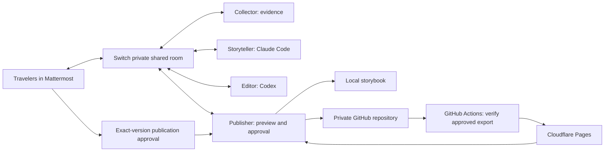

# MemoryWeaver

**Turn Scattered Memories into Beautiful Stories.**

A photograph of the sea. A message about the biggest whale shark you have ever seen. A quiet “let’s come back.” MemoryWeaver brings those fragments together into a travel book, with people and AI teammates sharing one creative room through **Switch**.

Built for [Flip the Switch](https://www.wemakedevs.org/hackathons/switch), Track 2: Best Personal or Creative Workflow.


## Try it on your own machine

Prerequisites: **Docker Desktop / Docker Engine with Compose v2, Git, and Python 3.9+**. Start Docker first. Allow roughly 8 GB RAM and several GB of disk for the initial image build. Internet access is required for the first build and for live model calls. Apple Silicon is supported; the official Mattermost image runs under amd64 emulation.

From a clone of this repository:

```sh
git clone https://github.com/Tetsuya-Uchimura/memoryweaver-stories.git
cd memoryweaver-stories
python3 scripts/dev.py up
python3 scripts/dev.py seed --generate
python3 scripts/dev.py credentials
```

Open **[MemoryWeaver](http://localhost:8787)** and **[Mattermost](http://localhost:8065)**. Sign in to Mattermost with the locally generated `MATTERMOST_USER` and `MATTERMOST_USER_PASSWORD` printed by the credentials command. Open the private **okinawa-memories** channel in the **memoryweaver** team.

The `up` command fetches the audited official Switch source, builds it, starts PostgreSQL and Mattermost, runs Switch’s own setup job, registers four custom agents, creates a private bridged room, and starts the book application. It generates fresh secrets in a gitignored, owner-readable `.env`. The `seed --generate` command posts six deliberately shuffled fictional memories and four licensed illustrative photographs using two actual Mattermost accounts, then asks the Collector to make a book. This repository is currently private; reviewers need repository access to clone it.

**The default is an explicitly labeled REPLAY DEMO.** It uses real Mattermost, real Switch, real room documents, real targeted handoffs, and deterministic extractive writing. It requires no AI, GitHub, or Cloudflare account. It is useful for checking infrastructure; it is **not evidence of live AI generation**. For the full creative workflow, enable live mode below.

After the first build, `python3 scripts/dev.py up` reuses the same accounts, room, data, and authentication volume. `seed` is idempotent. No developer account or credentials are bundled.

## Use Claude Code and Codex

The two pinned CLIs are installed **inside the agent image**. Authenticate your own accounts:

```sh
python3 scripts/dev.py auth claude
python3 scripts/dev.py auth codex
```

Follow Claude Code’s browser/link flow and Codex’s device-code flow. Codex device authentication may need enabling in your account security settings. Provider sign-in, subscription/model availability, consent, and device verification cannot be automated. Authentication persists in a private Docker volume, not the repository. We never copy a host machine’s AI credentials.

Change `AI_MODE=replay` to `AI_MODE=live` in your generated `.env`, then run:

```sh
python3 scripts/dev.py up
python3 scripts/dev.py seed --message '@mw-collector 今回の沖縄旅行をアルバムにして'
```

In live mode, Storyteller calls **Claude Code** with a structured album schema; Editor calls **Codex** with a separate structured editorial review. Collector and Publisher are deterministic tool agents. Optional `CLAUDE_MODEL` and `CODEX_MODEL` settings let you select models your accounts can access; otherwise the authenticated CLIs choose their defaults. Live results are never silently replaced by replay output.

This is a custom Switch protocol integration, not a Switch Console sidecar. **Switch Console and its separate onboarding are not required** for this Docker deployment. The project does not bypass provider authentication.

## Make it personal

Post photographs and short messages in the Mattermost room. Multiple contributors can participate. A timestamp prefix is optional:

```text
[2026-10-13T10:30:00+09:00] 美ら海水族館へ。ジンベエザメが想像以上に大きかった！
```

An explicit capture date takes precedence over upload time. Without one, the upload time is used and should be reviewed. Photo GPS/EXIF is removed; the app does not infer an itinerary or identities from an image. Storyteller receives the source text and photo references; the live Codex Editor can inspect up to eight sanitized photographs for visual consistency and selection. Captions provide the factual context of what happened, who was there, and when. Without captions, an image supports neutral visual description, not invented events.

Ask in Mattermost:

```text
@mw-collector 今回の沖縄旅行をアルバムにして
@mw-collector 2日目の文章をもっと感動的にして
@mw-collector 表紙を夕日の写真に変更して
@mw-collector 妻が投稿したコメントも反映して
```

For a new event, first post its actual date, words and photograph, then request an update. Plain generation/edit phrases also work; mentioning the Collector is the most reliable way to distinguish instructions from memories. The book UI’s editing dialog prepares an instruction to copy into Mattermost; it does not impersonate you or silently send a message.

You can also attach a photograph **to the editing request itself**, such as `@mw-collector Please add this photo to the album as well.` Put any factual caption on a separate line. The photograph is retained while the command is excluded from narration and quotations. An optional timestamp prefix on the caption line supplies the capture date. Without one, the date is explicitly labeled as the posting date; the replay book shows a photo note rather than inventing another travel day or extending the trip dates. Completion links with `?version=N` preserve that edition. Open `http://localhost:8787/` to follow the latest updates.

The book updates automatically. Read the original posts behind a chapter, inspect the collaboration feed, switch to photographs, or revisit earlier versions. On a phone, navigation moves to the bottom of the screen.

**Receive the finished work without leaving Mattermost.** Publisher posts the title and version-specific web album URL directly in the same private channel, with a cover-image preview and the actual Japanese PDF attached in one post. Edits produce a new completion post and updated PDF. Switch's standard media API carries both files using the Publisher bot; no additional Mattermost credentials or PDF service are needed. See [Mattermost delivery](docs/MATTERMOST-DELIVERY.md) for details and retry commands.

## Why Switch is essential



Each role is an independent process with its own Switch agent identity and Mattermost bot. Evidence, draft, and review are **Switch room documents**, visible in the same collaboration context. Each recipient loads its predecessor’s document **from Switch**, then posts a targeted handoff. Source messages, human edits, progress, and requests for clarification share the room. The application database stores preview versions and processing receipts, not a substitute inter-agent message bus.

Removing Switch stops intake, document access, handoffs, edits, and publication approval. This is not an application that calls several models itself and mirrors a transcript to chat. There is one deliberately bounded workflow per travel room; concurrent edits are refused until the current edit finishes, instead of overwriting a collaborator’s work.

The Editor checks evidence and can return a clarification request to the human. After a clarification, mention the Collector to start a new review. Every generated chapter must cite real posts, reference available photos, and use verbatim source quotes. These checks establish provenance, not a mathematical guarantee of factual prose. Review AI-written narration before sharing it.

## Publish only after you approve

Cloud publishing is **disabled by default**. The local experience is complete without cloud accounts.

When ready, use **Review publication** beneath the book. It shows the exact version, selected photos, and a command such as:

```text
PUBLISH v3 <digest-from-your-preview> I CONSENT TO PUBLIC PHOTOS AND TEXT
```

Only the configured `traveler` account can authorize that exact version through Mattermost. An in-progress edit or a newer version invalidates the command. The digest binds the book and the selected photographs’ byte hashes. With publishing disabled, approval produces a sanitized **local export only**. With publishing enabled, it atomically commits the export to a **private** GitHub repository, waits for GitHub Actions → Cloudflare Pages, and replies with the actual deployment URL in Mattermost.

Read [Cloud publishing](docs/PUBLISHING.md) before enabling it. A public Pages URL is public even when GitHub is private. Sharing is a separate, intentional step, and later edits need fresh approval.

For the developer repository, `python3 scripts/setup_publishing.py` creates/adopts the optional Cloudflare Direct Upload project and saves the required secrets to GitHub’s `production` environment using hidden terminal input. It runs a read-only Actions readiness check and never deploys a book. `python3 scripts/setup_publishing.py --publisher-token` configures a separately scoped GitHub token for the local Publisher and keeps `PUBLISH_ENABLED=false`. These optional commands are unnecessary for local judging.

## What is automatic, and what is not

| Item | Behavior |
| --- | --- |
| Official Switch runtime | Automatically fetches and verifies commit `6e4ade5269d65ee38060a9f43b77c5e5b3be2f10`; builds upstream Dockerfiles |
| Mattermost, admin, team, traveler and bridge | Upstream setup job; no manual System Console configuration |
| Four agents, addressing, private bridged room | Project bootstrap through audited Switch operations |
| Safe sample contributors and photo posts | `seed` through Mattermost’s actual API |
| Claude Code / Codex sign-in | Human authentication, required by the providers |
| Switch Console sign-in | Not needed for this custom protocol implementation |
| GitHub and Cloudflare | Optional, developer-provided configuration; never required for local judging |
| Production publication | Explicit human consent to each exact version |

## Development and verification

```sh
uv venv --python 3.12 .venv
uv pip install --python .venv/bin/python -r requirements-dev.txt
.venv/bin/python -m pytest -q
npm ci
npx playwright install chromium
npm run test:browser
```

Browser checks expect the Docker stack to be running in replay mode with the sample book generated. The integration check drives real Mattermost requests:

Host-side PDF tests require Pango; on Apple Silicon with Homebrew, use `DYLD_FALLBACK_LIBRARY_PATH=/opt/homebrew/lib .venv/bin/python -m pytest -q` after installing Pango. The judge's Docker setup already includes native libraries and Japanese fonts; no host font or PDF installation is required.

If you prefer an already installed Google Chrome, use `PLAYWRIGHT_CHANNEL=chrome npm run test:browser` instead of downloading Chromium. A real iPhone or Safari still needs separate device testing.

```sh
python3 scripts/dev.py compose run --rm --no-deps -T bootstrap python -m scripts.smoke
```

Run `python3 scripts/check_secrets.py` before committing. This checks distributable Git files against your generated local secrets without printing them.

Useful commands:

```sh
python3 scripts/dev.py status
python3 scripts/dev.py logs collector storyteller editor publisher
python3 scripts/dev.py compose exec editor codex login status
python3 scripts/dev.py compose exec storyteller claude auth status
python3 scripts/dev.py down
```

`down` keeps data and authentication volumes. It does not erase your memories. The web UI and upstream ports bind to loopback; this development stack is not an internet-facing multi-user service. See [Security](docs/SECURITY.md), [Architecture and Switch source audit](docs/SWITCH.md), [Demo script](docs/DEMO.md), and [Verification record](docs/VERIFICATION.md) for important details and tested boundaries.

## Repository map

```text
app/                  Private FastAPI preview, SQLite versions, book UI
agents/               Switch protocol client, four workers, model harnesses, publisher
scripts/              Portable bootstrap, Mattermost samples, release verifier, smoke test
samples/              Fictional source memories and licensed photo metadata
docs/                 English setup, design, security, demo and verification notes
.github/workflows/    Tests and approval-export-only Cloudflare deployment
.runtime/             Ignored upstream checkout and local artifacts (never publish)
```

Application code is licensed under MIT. Sample photos retain their individual licenses; see [photo credits](docs/PHOTO-CREDITS.md). Switch is a separate dependency with its [own license](https://github.com/sandbox-quantum/switch/blob/6e4ade5269d65ee38060a9f43b77c5e5b3be2f10/LICENSE). Claude Code and Codex are separately distributed provider tools.
